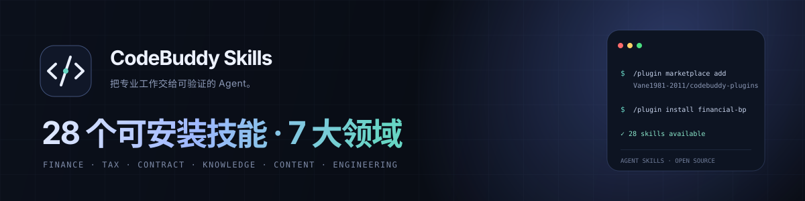
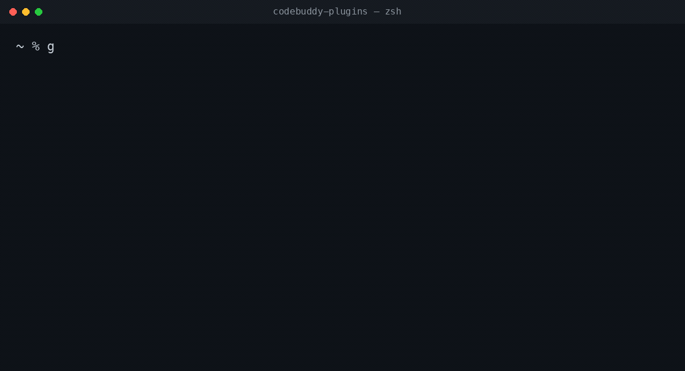
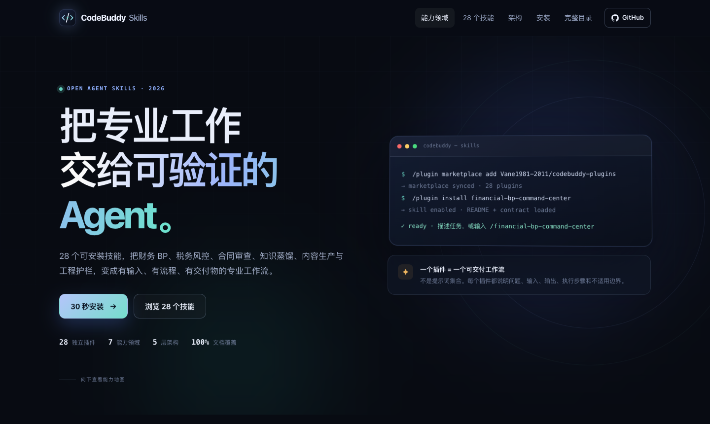
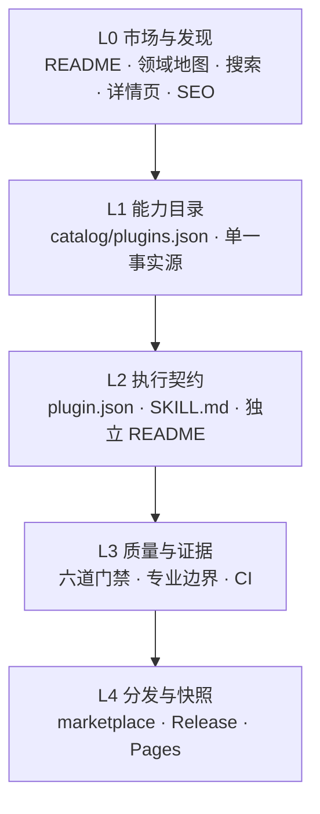

<p align="center">
  
</p>

<h1 align="center">CodeBuddy Skills</h1>

<p align="center"><strong>把专业工作交给可验证的 Agent。</strong><br>
28 个可安装的 AI Agent 技能：财务 BP、税务风控、合同审查、知识蒸馏、内容生产与工程护栏。</p>

**两行命令装走一个插件（复制即用）**

```text
/plugin marketplace add Vane1981-2011/codebuddy-plugins
/plugin install financial-bp-command-center
```

装完直接描述任务，或显式调用 `/financial-bp-command-center`。需要支持 CodeBuddy / WorkBuddy 插件市场的宿主；其他宿主见[安装指南](docs/INSTALL.md)。

<p align="center">
  <a href="https://github.com/Vane1981-2011/codebuddy-plugins/actions/workflows/validate.yml"></a>
  <a href="https://github.com/Vane1981-2011/codebuddy-plugins/releases"></a>
  
  
  <a href="LICENSE"></a>
  <a href="https://vane1981-2011.github.io/codebuddy-plugins/"></a>
</p>

<p align="center">
  <a href="https://vane1981-2011.github.io/codebuddy-plugins/"><strong>在线展示</strong></a> ·
  <a href="docs/SKILL-CATALOG.md"><strong>完整目录</strong></a> ·
  <a href="docs/INSTALL.md"><strong>安装指南</strong></a> ·
  <a href="docs/ARCHITECTURE.md"><strong>架构设计</strong></a> ·
  <a href="docs/BENCHMARK.md"><strong>高星项目对标</strong></a> ·
  <a href="https://github.com/Vane1981-2011/codebuddy-plugins/issues"><strong>问题反馈</strong></a>
</p>

<p align="center">
  
</p>

**不是口头承诺**：对标 7 个高星技能仓库逐项拆解，结论是"高星项目的共同点不是写得更多，而是让人 10 秒内看懂、30 秒内装上、3 分钟内判断是否适合自己"——差距清单与已补齐项见 [docs/BENCHMARK.md](docs/BENCHMARK.md)。

---

## 这是什么

这不是一个提示词合集，而是一套**可发现、可安装、可执行、可验证、可分发**的 Agent 技能产品：

- **28 个插件**：每个都是独立安装单元，可以单独使用，也可以组合成端到端工作流。
- **7 大领域**：从元技能与智能体，到商业金融、知识文档、软件工程、内容创意、办公协作与行业垂直。
- **统一执行契约**：每个插件都说明问题、最小输入、主要输出、执行流程、示例和不适用边界。
- **可检查的质量门**：目录、市场、插件清单、技能状态与文档由 CI 自动校验。

面向需要把专业判断变成可复用工作流的人：财务 BP、税务与合同审查、知识管理、内容生产、软件交付与 Agent 系统建设者。

<p align="center">
  
</p>

## 7 大领域，各自能实现什么

| 领域 | 插件 | 能实现的核心能力 |
|---|---:|---|
| ◎ **元技能与智能体** | 7 | 跨会话上下文、第一性原理推理、MAD 并行推理、技能资产治理、多智能体信任与质量门禁 |
| ◆ **商业与金融** | 5 | 财务 BP 经营分析、税务风险预警、合同风险扫描、投资风险量化、统一风险排序 |
| ▤ **知识与文档** | 5 | 拆书成技能、结构化文档共创、多格式转 Markdown、PDF 全生命周期、阅读笔记整理 |
| ⌘ **软件工程** | 5 | 高级前端交付、单文件应用工程护栏、多模态桥接、Agent 全链路时延与能力诊断 |
| ✦ **内容与创意** | 4 | 多 Agent 创意辩论、AI 绘本生产、声明式视频生产、文案情绪到 BGM 搜索 |
| ◇ **办公与协作** | 1 | 任务收尾时的上下文压缩、记忆写入与冗余清理 |
| ▣ **行业垂直** | 1 | 浏览器自动化执行、双通道与时钟校准、五层守护 |

## 28 个插件

按领域折叠展示。每个插件都有独立 README、安装命令、输入输出和适用边界。

<details open>
<summary><strong>◎ 元技能与智能体 · 7</strong></summary>

| 插件 | 一句话 | 安装 |
|---|---|---|
| [上下文管理器](plugins/context-manager/README.md) | 让下一次对话记得这一次的结论 | `/plugin install context-manager` |
| [专家市场同步器](plugins/expert-sync/README.md) | 让能力库跟着专家市场持续更新 | `/plugin install expert-sync` |
| [第一性原理推理](plugins/first-principles-reasoning/README.md) | 把复杂问题拆到不可再拆的事实 | `/plugin install first-principles-reasoning` |
| [上下文学习机制](plugins/in-context-learning/README.md) | 管理注意力预算，而不是堆更多提示词 | `/plugin install in-context-learning` |
| [稽影 · 多智能体信任基础设施](plugins/jiying/README.md) | 让多智能体的每一步都可追溯、可拦截 | `/plugin install jiying` |
| [MAD 深度推理管线](plugins/mad-think-pipeline/README.md) | 把复杂判断拆成可交叉验证的并行路径 | `/plugin install mad-think-pipeline` |
| [技能智能中枢](plugins/skill-intelligence/README.md) | 从「找技能」升级为「管理能力资产」 | `/plugin install skill-intelligence` |

</details>

<details>
<summary><strong>◆ 商业与金融 · 5</strong></summary>

| 插件 | 一句话 | 安装 |
|---|---|---|
| [财务 BP 指挥中心](plugins/financial-bp-command-center/README.md) | 把业财融合方法变成可计算的经营工具 | `/plugin install financial-bp-command-center` |
| [税务风险预警引擎](plugins/tax-risk-early-warning-engine/README.md) | 用指标和阈值把税务风险前置 | `/plugin install tax-risk-early-warning-engine` |
| [合同风险扫描器](plugins/contract-risk-scanner/README.md) | 签字之前，先把不利条款找出来 | `/plugin install contract-risk-scanner` |
| [风险评估矩阵](plugins/risk-assessment-matrix/README.md) | 把风险从形容词变成可排序的决策项 | `/plugin install risk-assessment-matrix` |
| [投资风险量化引擎](plugins/investment-risk-engine/README.md) | 用收益、回撤与组合指标检验投资判断 | `/plugin install investment-risk-engine` |

</details>

<details>
<summary><strong>▤ 知识与文档 · 5</strong></summary>

| 插件 | 一句话 | 安装 |
|---|---|---|
| [仓颉技能工坊](plugins/cangjie-skill/README.md) | 把一本书蒸馏成一组可执行技能 | `/plugin install cangjie-skill` |
| [结构化文档共创](plugins/doc-coauthoring/README.md) | 先对齐读者，再写内容 | `/plugin install doc-coauthoring` |
| [MarkItDown 文档转换](plugins/markitdown/README.md) | 把多种格式统一成可检索的 Markdown | `/plugin install markitdown` |
| [PDF 全能工具箱](plugins/pdfkit-py/README.md) | 五十条命令覆盖 PDF 全生命周期 | `/plugin install pdfkit-py` |
| [微信读书助手](plugins/weread-skills/README.md) | 把阅读痕迹整理成可用的知识笔记 | `/plugin install weread-skills` |

</details>

<details>
<summary><strong>⌘ 软件工程 · 5</strong></summary>

| 插件 | 一句话 | 安装 |
|---|---|---|
| [高级前端交付](plugins/frontend-dev/README.md) | 从界面、动效到文案的一次性交付 | `/plugin install frontend-dev` |
| [单文件应用工程护栏](plugins/spa-engineering-guard/README.md) | 让单文件 HTML 应用也能工程化交付 | `/plugin install spa-engineering-guard` |
| [多模态桥接层](plugins/multimodal-bridge/README.md) | 为纯文本模型接上图像、视频和 3D 能力 | `/plugin install multimodal-bridge` |
| [τ 全链路诊断](plugins/tau-diagnosis/README.md) | 定位智能体系统真正的时延与能力瓶颈 | `/plugin install tau-diagnosis` |
| [τ 增强诊断](plugins/tau-diagnosis-zcode/README.md) | 并行推理与交叉验证版全链路诊断 | `/plugin install tau-diagnosis-zcode` |

</details>

<details>
<summary><strong>✦ 内容与创意 · 4</strong></summary>

| 插件 | 一句话 | 安装 |
|---|---|---|
| [创意策源引擎](plugins/creative-origin-engine/README.md) | 让创意先经受攻击，再成为方案 | `/plugin install creative-origin-engine` |
| [AI 绘本生产线](plugins/picture-book-pipeline/README.md) | 从故事结构到版面一致性的完整流水线 | `/plugin install picture-book-pipeline` |
| [声明式视频生产线](plugins/video-production-pipeline/README.md) | 用组件和参数复现视频生产 | `/plugin install video-production-pipeline` |
| [BGM 智能搜索](plugins/pixabay-bgm-search/README.md) | 从文案情绪找到合适的免费背景音乐 | `/plugin install pixabay-bgm-search` |

</details>

<details>
<summary><strong>◇ 办公与协作 · 1</strong></summary>

| 插件 | 一句话 | 安装 |
|---|---|---|
| [上下文清理协议](plugins/context-cleanup/README.md) | 任务收尾时释放上下文，而不是一直背着它 | `/plugin install context-cleanup` |

</details>

<details>
<summary><strong>▣ 行业垂直 · 1</strong></summary>

| 插件 | 一句话 | 安装 |
|---|---|---|
| [浏览器自动化执行器](plugins/snap-up-assassin/README.md) | 双通道、时钟校准与五层守护的自动化模板 | `/plugin install snap-up-assassin` |

</details>

## 架构：五层，把技能变成产品



| 层 | 回答的问题 | 关键产物 |
|---|---|---|
| **L0 市场与发现** | 我为什么要看这个仓库？ | 首屏、领域地图、搜索、28 个详情页 |
| **L1 能力目录** | 有哪些能力，如何分类？ | `catalog/plugins.json` |
| **L2 执行契约** | 一个技能如何被安装和执行？ | `plugin.json`、`SKILL.md`、README |
| **L3 质量与证据** | 凭什么相信它？ | 质量门禁、专业边界、CI 校验 |
| **L4 分发与快照** | 如何升级、迁移、归档？ | marketplace、Release ZIP、Pages |

一个插件的最小结构：

```text
plugins/<name>/
├── README.md                       # 给人看：问题、输入、输出、安装
├── .codebuddy-plugin/plugin.json   # 给市场看：名称、版本、许可、技能入口
└── skills/<name>/SKILL.md          # 给 Agent 看：触发、流程、交付契约
```

## 组合工作流

插件可以单独使用，也可以按输入输出契约组合：

```text
合同风险扫描 → 税务风险预警 → 财务 BP 分析 → 投资风险量化 → 风险排序
知识格式转换 → 阅读笔记 → 拆书成技能 → 结构化文档共创
创意辩论 → 绘本生产 → 视频生产 → BGM 搜索
上下文加载 → 并行推理 → 信任门禁 → 上下文清理
```

## 质量门禁

| 门禁 | 通过条件 |
|---|---|
| 目录完整性 | 28 个插件、7 个领域、数量与名称一致 |
| 技能可加载 | 28/28 frontmatter 可解析，`disable` 不为 true |
| 插件可安装 | 28/28 `plugin.json` 合法，名称、版本、技能入口一致 |
| 文档完整 | 28/28 独立 README，含输入、输出、工作流与边界 |
| 展示一致 | 首页、28 个详情页、目录页与站内链接可解析 |
| 发布可复现 | 从单一事实源重建后，目录与市场一致 |

本地校验：

```bash
python3 scripts/build_catalog.py
python3 scripts/build_site.py
python3 scripts/validate_repo.py
```

详见 [质量门禁](docs/QUALITY.md)。

## 与高星项目的结构对标

我们拆解了 `obra/superpowers`、`anthropics/skills`、`addyosmani/agent-skills`、`ComposioHQ/awesome-claude-skills`、`vercel-labs/skills` 等公开仓库，提炼出七个共性：首屏一句话、30 秒安装、领域分类、独立边界、文档/示例/评估、视觉层级、发布与维护机制。

本仓库没有复制它们的内容，而是把结构映射到自己的真实能力上。完整对比、采样数据与落点见 [高星项目对标](docs/BENCHMARK.md)。

## 版本与发布

- 当前版本：`v1.0.0`
- 变更记录：[CHANGELOG.md](CHANGELOG.md)
- 发布说明：[RELEASE_NOTES.md](RELEASE_NOTES.md)
- 离线快照：GitHub Releases 中的 `codebuddy-plugins-v1.0.0.zip`
- 在线展示：<https://vane1981-2011.github.io/codebuddy-plugins/>

## 参与贡献

- 提交 Bug：[Bug Report](https://github.com/Vane1981-2011/codebuddy-plugins/issues/new?template=bug_report.yml)
- 请求新技能：[Skill Request](https://github.com/Vane1981-2011/codebuddy-plugins/issues/new?template=skill_request.yml)
- 贡献代码或文档：[CONTRIBUTING.md](CONTRIBUTING.md)
- 安全问题：[SECURITY.md](SECURITY.md)

## 许可与来源

- 根仓库：[MIT](LICENSE)
- `jiying` 插件：[Apache-2.0](plugins/jiying/LICENSE)
- 第三方来源与归属：[THIRD_PARTY_NOTICES.md](THIRD_PARTY_NOTICES.md)

---

<p align="center"><strong>如果这些工作流对你有用，给仓库一个 Star。</strong><br>
Star 不会让技能变强，但会让下一个需要它的人更容易找到这里。</p>

<p align="center">
  <a href="https://github.com/Vane1981-2011/codebuddy-plugins"></a>
</p>

<p align="center"><sub>Built by <a href="https://github.com/Vane1981-2011">Vane1981</a> · 13 年建安企业财税咨询与经营分析经验 · AI Agent 编排与专业工作流</sub></p>
